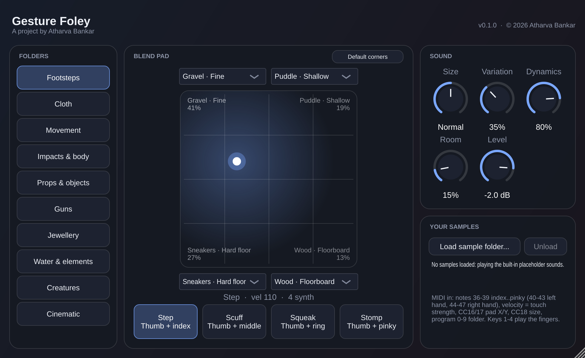

# Gesture Foley

Perform foley with your hands in front of a webcam: touch your thumb to a fingertip to play a sound.
Hand tracking (MediaPipe) → gesture detection → real-time sound **and MIDI into your DAW**.

**Try it in your browser:** https://atharvabankarsound.github.io/Gesture-foley/  
No install needed: allow camera access and touch your thumb to a fingertip.

### Plugin (AU / VST3, in progress)

The DAW plugin lives in [`plugin/`](plugin/README.md): a JUCE sound engine with the same folders, finger touches
and XY blend pad as the browser version, driven by MIDI from the hand tracker. It loads your own sample folder.



### Browser version

Touch your thumb to one fingertip, then open your hand again. One touch plays one sound.

| Folder | Thumb + index | Thumb + middle | Thumb + ring | Thumb + pinky | Textures (sub-categories) |
|---|---|---|---|---|---|
| Footsteps | Step | Scuff | Squeak | Stomp | 11 textures, 27 sub-categories (e.g. Wood › Floorboard, Deck, Stairs, Creaky) |
| Cloth | Grab | Snap | Zip | Body fall | 8 textures, 17 (e.g. Leather › Jacket, Belt, Gloves) |
| Movement | Whoosh | Long whoosh | Punch | Body hit | 6 textures, 12 (e.g. Stick › Staff, Whip) |
| Impacts & body | Punch | Slap | Kick | Body fall | Flesh, Wood, Metal, Glass, Ground: 14 |
| Props & objects | Pick up | Put down | Open | Close | Door, Drawer, Paper, Glassware, Plastic, Tools: 14 |
| Guns | Shot | Reload | Shell drop | Burst | 6 weapons, indoor/outdoor and more: 12 |
| Jewellery | Jingle | Shake | Drop | Handful | Keys, Coins, Chain, Bracelet, Beads, Bells: 12 |
| Water & elements | Small | Medium | Movement | Big | Water, Fire, Wind, Rain, Mud: 13 |
| Creatures | Step | Run | Scratch | Wings / land | Horse, Dog, Big creature, Bird: 10 |
| Cinematic | Hit | Braam | Riser | Boom | 6 textures, 12 |

143 sub-categories in total.

**Main pad.** Every folder has an XY pad with a sub-category in each corner. Pick each corner from
the menu or step through with the arrows, then drag the point: each hit mixes the four corners by
how close the point is (equal-power, so loudness stays even). *Steer the main pad with your hand*
moves the point with your palm while you perform.

**Layer pad.** A second pad that plays with every hit, from any folder: clothing under footsteps,
keys and chains under horses, whooshes under cinematic hits. *Plays* chooses which of the layer
folder's sounds it adds (the same finger, or always one sound).

**Size.** Small to Large changes the character's weight: pitch (±4 semitones), low end and brightness,
for samples and synth alike.

**Mixer.** Main and Layer channels with level, pan, mute and solo, plus Room (reverb) and Master.

**Templates.** 22 factory templates (Forest walk, Rainy street, Office heels, Soldier, Bar fight,
Car chase, Storm, Ranch, Trailer and more) set the pads, layer, size and layer level in one click.
Save your own, and export or import them as a file to move them between computers.

**Use your own samples.** The sound library grid has a cell for every texture and finger: drop audio
files on a cell, or use *Load a sample folder* on a whole kit folder.
Cells are per sub-category and finger, laid out like `Footsteps/Wood/Stairs/Step/`. Several samples in one cell play in random order, never the same one twice in a row. Samples are saved in
your browser. Empty cells use a synth placeholder.

**Why it's precise:**
- Fingertips are smoothed with a One Euro filter: steady when your hand is still, responsive when it moves.
- Each touch plays once. A finger re-arms only after it opens again (a filled dot on screen means ready, hollow means open your fingers).
- Only the clearly closest finger can play, so two sounds never fire together.
- A hand entering the frame is ignored for 0.3 s, fast hand movement blocks triggers, and a fist doesn't count.

How fast your fingers close sets the velocity (louder and brighter). *Dynamics* sets how much that matters,
*Variation* adds small random pitch and level changes, and *Reverb* adds space.

Code: `docs/gestures.js` (gesture detection), `docs/blend.js` (blend pad maths), `docs/samples.js` (sample playback),
`docs/sounds.js` (sound catalogue and synth placeholders), `docs/templates.js` (factory templates), `docs/app.js` (interface). Bundled samples for everyone can go in
`docs/samples/` (see the README there).

Listen to the built-in surfaces: [`media/surfaces_demo.wav`](media/surfaces_demo.wav)

## Setup (macOS)

Use Python 3.10–3.12 (MediaPipe can lag behind the newest Python).

```bash
cd gesture-foley
python3 -m venv .venv
source .venv/bin/activate
pip install -r requirements.txt
python gesture_foley.py
```

The first run downloads the hand-tracking model (`hand_landmarker.task`, a few MB).
If the camera doesn't open: **System Settings → Privacy & Security → Camera**
and allow Terminal (or VS Code), then run again.

## How to perform (Python tracker)

The Python script is the hand tracker for the [plugin](plugin/README.md). It uses the same touch
engine as the website and sends MIDI to the plugin, which plays the foley.

| Touch | Sound |
|---|---|
| Thumb + index | Sound 1 of the folder (e.g. Step) |
| Thumb + middle | Sound 2 (e.g. Scuff) |
| Thumb + ring | Sound 3 (e.g. Squeak) |
| Thumb + pinky | Sound 4 (e.g. Stomp) |

- How fast your fingers close sets the velocity.
- Open your fingers again before the next touch. On screen, a filled fingertip dot means ready and a hollow one means open again first.
- Left hand plays slightly left, right hand slightly right.

| Key | Action |
|---|---|
| 1–9, 0 | Folder: Footsteps, Cloth, Movement, Impacts, Props, Guns, Jewellery, Elements, Creatures, Cinematic |
| p | Pad follows hand on/off (your left hand, or the only hand, moves the blend point) |
| [ / ] | Size smaller / larger |
| + / − | Touch distance up / down |
| space | Test touch |
| q / Esc | Quit |

Click the video window before pressing keys.

## Recording into Reaper with the plugin

While the script runs it creates a virtual MIDI port called **Gesture Foley**, using the plugin's MIDI map:

| MIDI | Does |
|---|---|
| Notes 40–43 | Left hand: thumb + index, middle, ring, pinky |
| Notes 44–47 | Right hand: the same |
| Notes 36–39 | Both hands, with `--one-channel` |
| CC 16 / 17 | Blend pad X / Y (with "pad follows hand" on) |
| CC 18 | Size |
| Program change 0–9 | Folder |

*(Reaper may show note 36 as C2. The numbers are what matter.)*

1. **Start the script first**, then open Reaper (the port only exists while the script is running).
2. **Enable the port:** Reaper → Settings → Audio → **MIDI Inputs** → right-click *Gesture Foley* → **Enable input**.
   If it's missing, start the script and click *Reset all MIDI devices* (or restart Reaper).
3. **Make a track** with the Gesture Foley plugin, **record-arm** it, set its input to
   **MIDI → Gesture Foley → All channels**, and turn **record monitoring** on.
4. **Record** and perform along with your picture. The touches land as MIDI notes you can nudge and
   re-velocity in the MIDI editor, and the plugin plays them back with your samples.

With MIDI on, the script stays silent so you don't hear two sounds. With `--no-midi` (or `--sound`)
it plays a simple built-in footstep preview instead.

```bash
python gesture_foley.py --list-midi            # show MIDI ports
python gesture_foley.py --no-midi              # preview sound only, no plugin
python gesture_foley.py --midi-port "loopMIDI Port"   # Windows (virtual ports aren't supported; use loopMIDI)
python tests/test_tracker.py                   # check the tracker against the website's engine
```

## Tuning tips

- Touches missed → press `+` (larger touch distance). Sounds firing before your fingers meet → press `−`.
- Keep your other fingers extended while touching; a curled hand is treated as a fist and doesn't play.
- Sit 50–80 cm from the camera with good light. Distance doesn't change sensitivity, because
  everything is measured relative to the size of your hand.
- Check "Camera FPS" in the HUD. 30 fps works; 60 fps feels noticeably tighter.
- Recorded notes land slightly late (camera + tracking delay). Select them in Reaper and nudge
  them earlier, or use the track's MIDI input offset. We'll measure and automate this later.

## Roadmap

1. ~~Stage 1: camera → gestures → synthesized steps~~
2. ~~Stage 2: MIDI out → editable performance in Reaper~~
3. ~~Finger-touch gestures, sound library and glass UI in the browser~~
4. JUCE plugin (VST3/AU) with a sample-based engine (v0.1 done: engine, blend pad, your samples, MIDI map); tracker on the plugin's note map done; next: layer pad, templates, then hand tracking inside the app
5. Recorded sample library and a trained gesture classifier

## Copyright

© 2026 Atharva Bankar. All rights reserved.

This project is proprietary. The code is public so it can be viewed and the demo tried,
but it may not be copied, modified, redistributed or reused without written permission.
See [LICENSE](LICENSE). Third-party components (MediaPipe, Python packages) keep their own licences.
