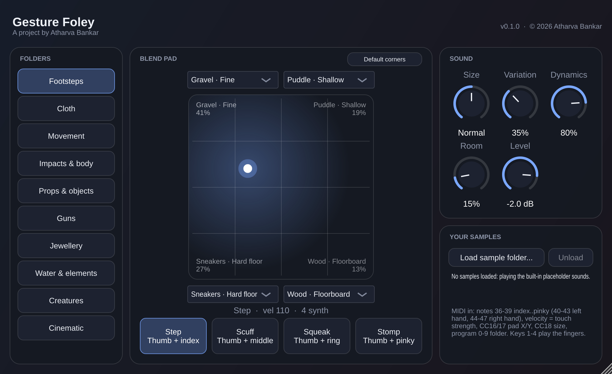

# Gesture Foley: plugin (JUCE)



The plugin is the sound engine of Gesture Foley in your DAW. You perform with your hands in
front of the webcam, the tracker sends MIDI, and the plugin plays the foley: the same folders,
sub-categories, four finger touches and XY blend pad as the web demo.

```
webcam ──► hand tracker (gesture_foley.py now, built into the app later) ──MIDI──► Gesture Foley plugin ──► your DAW
```

**v0.1 (this version):** AU, VST3 and Standalone. Ten folders, 143 sub-categories, blend pad
with selectable corners, Size, Variation, Dynamics, Room and Level, loads your own sample
folder (same layout as the Gesture Foley Kit), and has placeholder synth sounds for empty cells.

## MIDI map

| MIDI | Does |
|---|---|
| Notes 36, 37, 38, 39 | Thumb + index, middle, ring, pinky (centre) |
| Notes 40 to 43 | The same, left hand (panned slightly left) |
| Notes 44 to 47 | The same, right hand (panned slightly right) |
| Velocity | How hard the fingers met (Dynamics sets how much it matters) |
| CC 16 / CC 17 | Blend pad X / Y |
| CC 18 | Size (small to large) |
| Program change 0 to 9 | Folder: Footsteps, Cloth, Movement, Impacts & body, Props & objects, Guns, Jewellery, Water & elements, Creatures, Cinematic |

In the plugin window, keys **1 to 4** (or clicking the finger pads) play the four touches, so you can try it without the tracker.

## Your samples

Click **Load sample folder...** and choose your kit folder. The plugin sorts files the same way
the website does:

```
Footsteps / Wood / Stairs / Step (thumb + index) / step_01.wav
Folder    / Texture / Sub-category / Sound (finger) / your files
```

- WAV, AIFF, FLAC, MP3 and Ogg. One sound per file, silence trimmed from the start.
- Up to 24 takes per cell, 20 seconds and 30 MB per file. Takes play in random order, never the same one twice in a row.
- Cells without samples play the built-in placeholder sound, so a half-filled kit still works.
- The folder is remembered in your DAW session and reloaded when the session opens.
- Your commercial libraries stay on your drive: nothing is copied into the plugin or the project.

## Building it

You need CMake 3.22+ and a C++20 compiler. JUCE 9.0.5 is downloaded automatically on the first build.

**Mac** (Xcode or the Xcode command line tools, `brew install cmake`):

```bash
cd plugin
cmake -B build -G Xcode -DGF_COPY_AFTER_BUILD=ON
cmake --build build --config Release
```

`GF_COPY_AFTER_BUILD=ON` copies the AU into `~/Library/Audio/Plug-Ins/Components` and the VST3
into `~/Library/Audio/Plug-Ins/VST3`. Rescan plugins in Reaper (or restart Logic) and look for
**The Richmond Studios > Gesture Foley**. Builds are universal (Apple silicon and Intel).

**Windows** (Visual Studio 2022 with "Desktop development with C++"):

```bash
cd plugin
cmake -B build
cmake --build build --config Release
```

**Linux:** install the packages in JUCE's `docs/Linux Dependencies.md`, then build as above.

Run the engine tests with `build/GestureFoleyTests_artefacts/Release/GestureFoleyTests`.

Every push to GitHub also builds the Mac and Linux versions and runs the tests (see the
**Actions** tab). The Mac build can be downloaded from there. It isn't signed yet, so macOS
will block it the first time: run `xattr -dr com.apple.quarantine` on the plugin, or build it yourself.

## Using it with the tracker in Reaper

1. Start the tracker: `python gesture_foley.py --midi` (it creates a virtual MIDI port called "Gesture Foley").
2. In Reaper: Preferences > Audio > MIDI Devices, enable the "Gesture Foley" input.
3. Insert a track with the Gesture Foley plugin, arm it, and set its input to MIDI > Gesture Foley.
4. Perform. Record-arm the track to capture your takes as MIDI and audio.

The Python tracker still sends the older gesture notes. Moving it to the four-touch engine and
this note map is the next step.

## Code

| File | What it does |
|---|---|
| `Source/Engine.*` | Real-time engine: blend layers, sample playback, voice stealing, Size/Variation/Dynamics, Room. No locks or allocation on the audio thread |
| `Source/Blend.h` | XY pad maths, identical to `docs/blend.js` |
| `Source/Router.*` | Works out where a file belongs from its folder path, identical to the website's import |
| `Source/SampleLibrary.*` | Loads a sample folder on a background thread |
| `Source/FallbackSynth.*` | Placeholder sounds for empty cells |
| `Source/Taxonomy.*` + `Resources/taxonomy.json` | The folder list, exported from the web demo by `tools/export_taxonomy.mjs` |
| `Source/PluginProcessor.*` | Parameters, MIDI map, saved state |
| `Source/PluginEditor.*`, `XYPad.*`, `Theme.h` | The window |
| `Tests/` | Engine tests, a VST3 host check and a window snapshot tool |

If you change folders or sub-categories in `docs/sounds.js`, run `node plugin/tools/export_taxonomy.mjs`
so the plugin matches.

## Licences

Gesture Foley is © 2026 Atharva Bankar, all rights reserved (see `../LICENSE`).
It is built with [JUCE](https://juce.com), which is dual-licensed (AGPLv3 or a commercial
JUCE licence). To sell Gesture Foley as closed-source software you need a commercial JUCE
licence; JUCE offers a free tier for small businesses, so check its current terms before release.
VST is a trademark of Steinberg Media Technologies GmbH.
